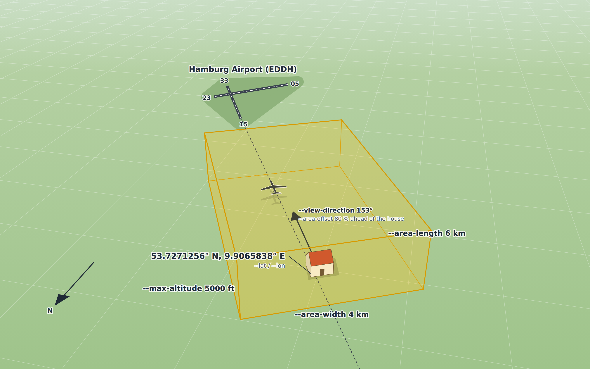
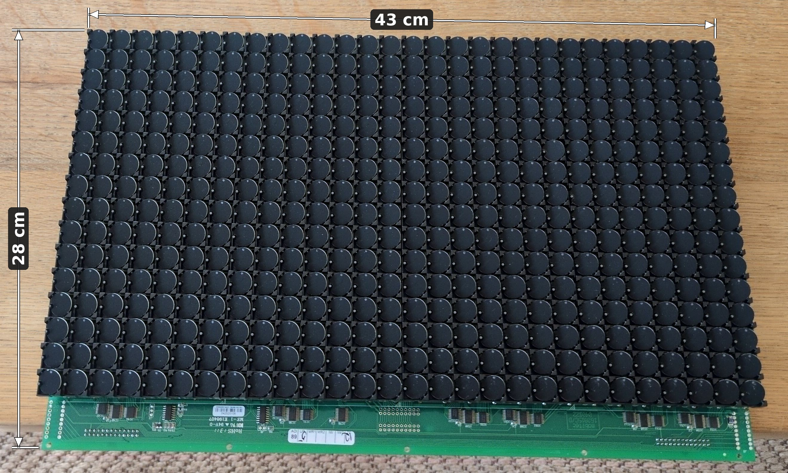
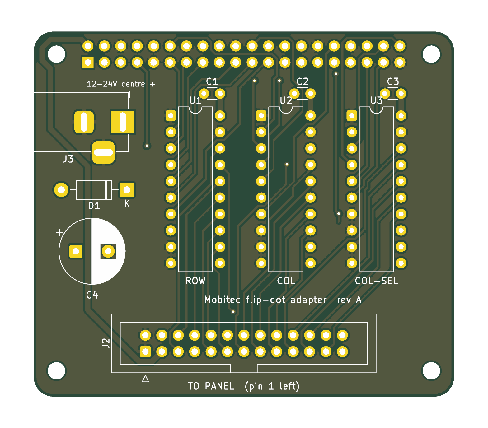
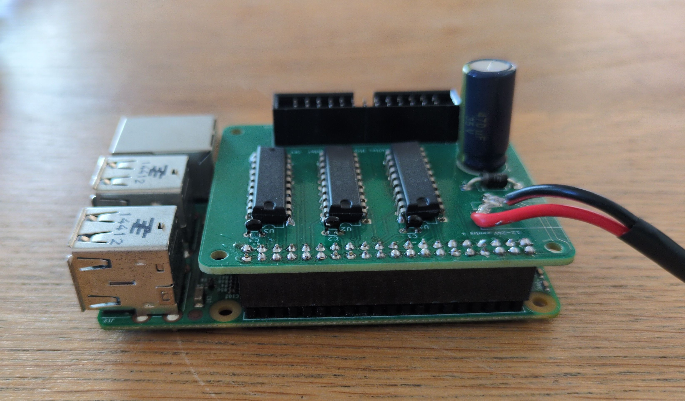
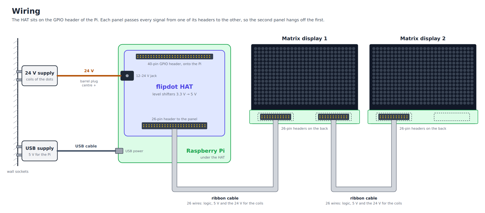

# ADS-B FlipDot

As an avid aviation nerd who happens to live almost exactly on the extended centerline of EDDH's RWY 15, I have a
constant stream of airplanes flying over my house. And although EDDH is a small airport that is rarely visited by
exciting aircraft, I still often step outside when I hear a plane approaching to see what is coming.

I am also a nerd and fully aware of apps like Flightradar24, but I wanted a dedicated device to show me what's flying
overhead, one that gives off some airport vibes instead of a boring mobile phone screen.

https://github.com/user-attachments/assets/cd77bf14-a6f2-4459-a4ed-02358a0cf8c3

## The plan

### ADS-B data

I do not want to rely on or pay for an API to run the displays. The data that Flightradar24 is based on can be received<video src="video/adsb-flipdot-video-embedded.mp4" controls muted playsinline width="100%"></video>
freely using an RTL2832U-based DVB-T stick, which can be tuned far beyond the standard television bands, up to
1090 MHz, to receive the ADS-B data the aircraft are broadcasting.

Looking into the [ADS-B message structure](https://mode-s.org/1090mhz/index.html), the most important information for
my use case is the current position as latitude and longitude, as well as the current heading and altitude.

Using this information I can create a virtual box around my house, catching all aircraft that cross this box at a
certain altitude and filtering out all other irrelevant traffic that is crossing overhead.



### Display

In an ideal world I would like to use a [split-flap](https://en.wikipedia.org/wiki/Split-flap_display) display like the
ones that were widely used at airports (some, e.g. EDDF, still have them). Looking at the prices for original modules
or even DIY alternatives, those are completely out of my price range for this project.

Luckily, the technology that replaced them is much more accessible.
[Flip-disc (or flip-dot)](https://en.wikipedia.org/wiki/Flip-disc_display) displays not only make a nice clicking noise
resembling that of split-flap displays, they can also show arbitrary glyphs. They were widely used as destination signs
in buses and are thus readily available on second-hand platforms.

### Processing

Because the data from ADS-B comes in via USB and needs a bit of processing power and driving the matrix display requires
quite a few I/O lines to address and drive the dots, a old Raspberry PI is a perfect fit for the task. I also wanted to
use this opportunity to get to know Rust a little bit closer, and there is a
nice [crate](https://docs.rs/rs1090/latest/rs1090/)
available that already can decode ADS-B messages.

## Implementation

### Display

#### The dots

The Mobitec is built from an array of small hinged discs with different colors on each side, that show as black or
yellow forming the dots.



The displays are chainable (up to 6 i Think). To understand how to drive them correctly without risking damage, we need to 
look a little bit deeper into how they work internally.


Each disc carries a small bar magnet along its length and sits above the two poles of a U-shaped iron core with a
coil wound around it. A short current pulse through the coil magnetises the core. Its poles pull the opposite ends of
the disc magnet, and the disc turns until each end of the magnet faces the opposite pole. Reversing the current swaps
the poles, and the disc turns half a turn to show its other face. After the pulse the disc magnet holds on to the iron
core, so the disc keeps its position without power and the coil only needs a short pulse to flip it.

The Mobitec has an 26 pin input header, allows to select each individual dot, and also to turn it back and forth.

#### Dot selection


A dot is picked by two 5 bit addresses, one for the row (pins 5, 7, 6, 8 and 9) and one for the column (pins 13 to
17). The panel does not decode them as plain numbers. The two upper bits pick one of several decoder chips, each of
which drives a group of seven lines, and the three lower bits pick one line of that group. A value of 0 in the lower
bits selects nothing, so every eighth address (0, 8, 16, 24) is skipped:

| Rows  | Address | Columns | Address |
|-------|---------|---------|---------|
| 1–7   | 1–7     | 1–7     | 1–7     |
| 8–14  | 9–15    | 8–14    | 9–15    |
| 15–16 | 17–18   | 15–21   | 17–23   |
|       |         | 22–28   | 25–31   |

For example, the dot in row 10, column 20:

|        | Number | Group | Line | Address    | Pins high  | Pins low |
|--------|--------|-------|------|------------|------------|----------|
| Row    | 10     | 1     | 3    | 11 = 01011 | 5, 7, 8    | 6, 9     |
| Column | 20     | 2     | 6    | 22 = 10110 | 14, 15, 17 | 13, 16   |

#### Flipping a dot


Once a dot is selected, three more signals decide what happens to it. Each row has two lines, one that can only feed
current into its coils and one that can only drain it, separated by a diode at every dot. The column has a single line
that can be connected to the coil supply or to ground.

- **Direction (pin 18)** picks which way the current runs through the coil. Low connects the row to the coil supply
  and the column to ground, and the dot turns yellow. High does the opposite, and the dot turns black.
- **Row enable (pin 11 ROW-LOW, pin 10 ROW-HIGH)** switches the row side on. Use pin 11 together with pin 18 low and
  pin 10 together with pin 18 high, and never set both at the same time.
- **Select (pin 19)** fires the dot. Current only flows while it is high, so a pulse of about 190 µs flips the dot.
  Keep it short: a coil that stays energised overheats.

So one dot is flipped in four steps: set the address and the direction, enable the row, pulse pin 19 and switch the
row off again before the next dot.

### Raspberry HAT

Dot selection and configuration of the flipping direction expects 5v logic, and although the Raspberry Pi has plenty of GPIO pins, they all only deliver 3.3v. To be able to drive the display via Raspberry Pi I designed small adapter HAT, that runs the GPIO pins through some levels shifters to deliver the correct 5v. 



All needed design files to manufacture the board are under `./pcb`. Once populated with three levels shifters and a few capacitators to smooth out the current when selecting and switching dots (see BOM at [flipdot-hat-assembly-bom.csv](pcb/assembly/flipdot-hat-assembly-bom.csv)) the HAT can be directly stacked on the Raspberry Pi GPIO pins, and connected to the display via a ribbon cable.






### Software

The software `adsb-flipdot` uses a virtual double-buffered Matrix display. Once new content is written the virtual display computes the diff on yellow/black dots from the previous content to avoid re-drawing the full matrix every time, which would be too time consuming. When no display is attached, the virtual display is written to the console to enable easier debugging.

```shell
./adsb-flipdot debug

Diagnostic tools

Usage: adsb-flipdot debug <COMMAND>

Commands:
  dump       Print every received Mode S / ADS-B frame to the console
  record     Save every received frame to a JSON lines file, for replay with --device-record-file
  all        Show a continuously updated table with one row per aircraft
  filter     Show aircraft passing a rectangle around a point, below an altitude
  flipdot    Preview text as dots, the way the flipdot panel will show it
  pi         Switch the signals of the adapter board on the Raspberry Pi by hand
  clear      Turn every dot of the panels to its dark side
  pattern    Show test patterns one after another, until stopped
  templates  List the codes that can be used in `live --template`
  help       Print this message or the help of the given subcommand(s)
```

The default lat/long parameters are tuned so the flight info is shown once the aircraft passes my house, this is how it looks in real life

https://github.com/user-attachments/assets/cd77bf14-a6f2-4459-a4ed-02358a0cf8c3

## Building and deploying

All tasks to build and deploy solutions are documented and executable via [mise](https://mise.jdx.dev)

```shell
 mise t
Name           Description
ansible        Set up a Raspberry Pi over SSH (udev rule + DVB blacklist), e.g. `mise ansible 10.42.0.112`
build          Build the project (debug)
build:pi       Cross-compile static release binaries for 64-bit and 32-bit Raspberry Pi (needs Docker)
build:pi:32    Cross-compile a static release binary for 32-bit Raspberry Pi, e.g. the Pi 2 (needs Docker)
build:pi:64    Cross-compile a static release binary for 64-bit Raspberry Pi (needs Docker)
check          Format check + clippy + tests
clean          Remove build artifacts
fmt            Format sources
fmt:check      Verify formatting
lint           Run clippy with warnings as errors
pcb:board      Place, autoroute and pour the board (build_board.py -> .kicad_pcb)
pcb:drc        Run DRC (-> pcb/drc.json)
pcb:generate   Regenerate all generated PCB files (board, DRC, gerbers, assembly, renders)
pcb:gerbers    Export gerbers and drill files (-> pcb/gerbers/)
pcb:placement  Export the placement file (-> pcb/assembly/)
pcb:render     Render pcb/top.png and pcb/bottom.png
pcb:zip        Pack pcb/gerbers/ and pcb/assembly/ into the upload zips
release        Build the project (release)
run            Run adsb-flipdot (release build), e.g. `mise run run debug dump`
setup-udev     Install udev rule + DVB blacklist for the RTL2832U dongle (needs sudo)
test           Run tests
```

