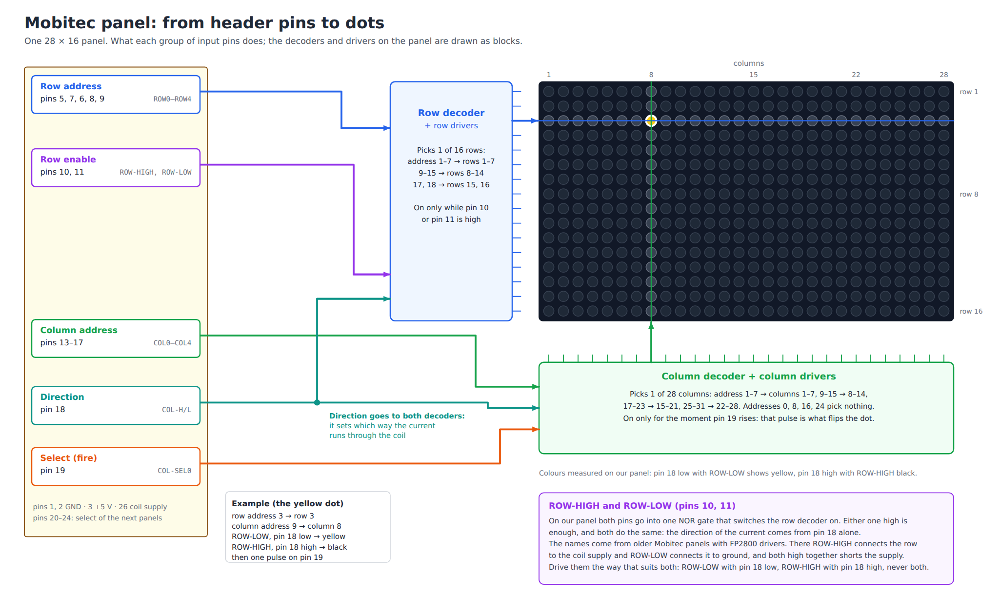
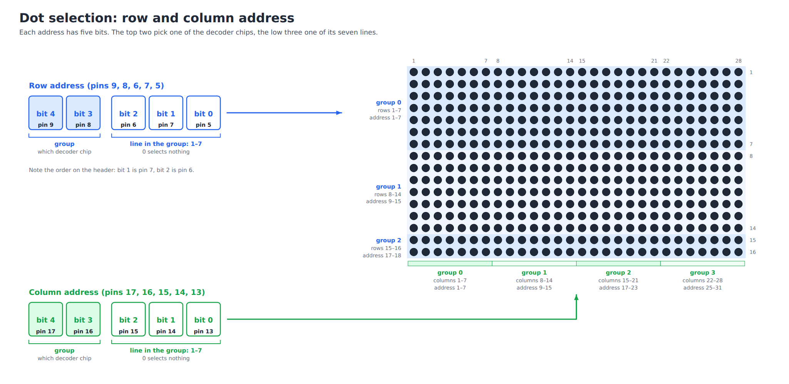
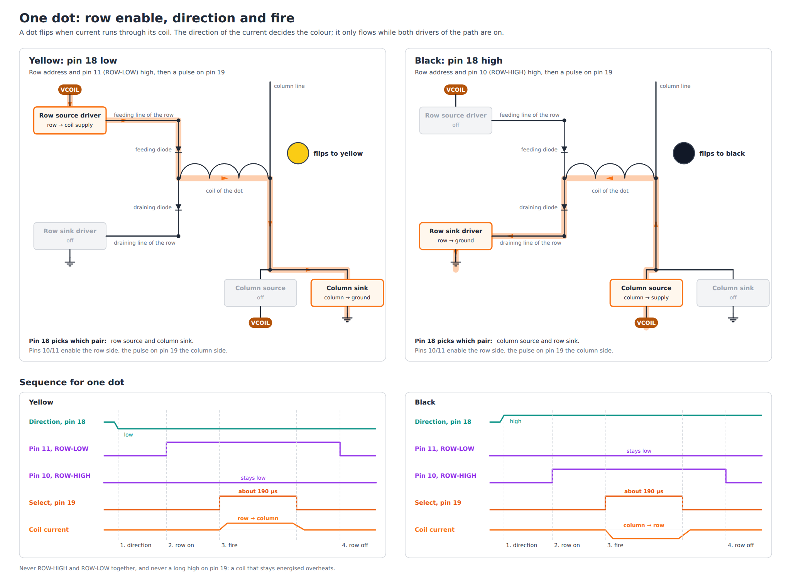
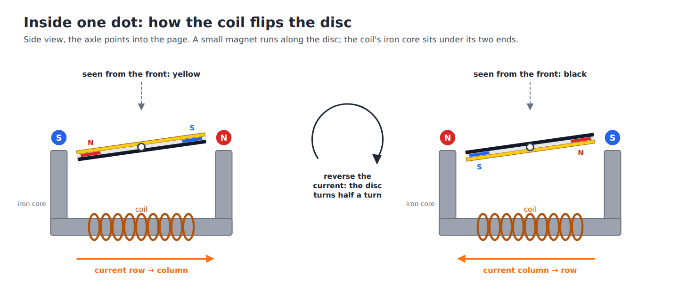

 # Mobitec flip-dot panel and adapter board

What is known about the 26-pin header of the bare Mobitec panels used in this
project, and how the adapter board in `pcb/` connects a Raspberry Pi to it.
The panel side is gathered from other people's reverse engineering.
**Only the supply pins have been measured on our own panels so far, and
nothing has been tried on the board yet.** The checks and their results are
in [verify-pinout.md](verify-pinout.md).

## The panels

- 28 columns by 16 rows, yellow dots, PCB marked `Mobitec 162015C/D`.
- Two shrouded 26-pin (2x13) headers on the solder side, one near each end,
  and more unpopulated 2x13 footprints along the top edge. Whether the two
  headers are wired pin for pin is not known yet.
- No FP2800 driver chips. The logic along the top edge is:

  | Marking            | Part                                   | Job                                    |
  |--------------------|----------------------------------------|----------------------------------------|
  | `HC4514`           | 74HC4514, 4-to-16 decoder with latch   | Picks one row or column line           |
  | `74HC139D`         | 74HC139, dual 2-to-4 decoder           | Picks which HC4514 is enabled          |
  | `74HC02D`          | 74HC02, four NOR gates                 | Inverts the direction, gates enables   |
  | `783AG`            | Probably TBD62783A, 8 source drivers   | Connects a line to the coil supply     |
  | `083AG`            | Probably TBD62083A, 8 sink drivers     | Connects a line to ground              |

  The two driver part numbers are read from the chip markings and are a guess.

This chip set matches the panel in Anton Christensen's schematic (source 3
below), which uses a 74HC4514, a 74LS139, a 7402, a TD62783 and a ULN2003A.
The Open Space Aarhus and Pico projects describe an older panel with FP2800
style drivers on the same connector.

## Pinout



Seen from the mating side of the header on the panel. On our panels, ground
on pins 1 and 2, 5 V on pin 3 and the coil supply on pin 26 are measured;
pin 4 is not connected to 5 V and pin 25 not to the coil supply.

Between the two headers of a panel, pins 1 to 3, 5 to 11, 13 to 18 and 26 are
connected pin for pin, and pins 4, 12 and 25 not at all. Pins 20 to 24 of one
header go to pins 19 to 23 of the other, so the select lines are shifted by
one from panel to panel. Pin 19 of the first header and pin 24 of the second
go to no pin of the other header.

```
                 26-pin header (2x13), 5 V logic

              GND    1 ■ ●  2   GND
              +5V    3 ● ●  4   n.c.
   ┌  ROW0           5 ● ●  6   ROW2          ┐
   │  ROW1           7 ● ●  8   ROW3          │ row address
   └  ROW4           9 ● ● 10   ROW-HIGH      ┐ row direction / enable
      ROW-LOW       11 ● ● 12   n.c.          ┘ (never both high)
   ┌  COL0          13 ● ● 14   COL1          ┐
   │  COL2          15 ● ● 16   COL3          │ column address
   └  COL4          17 ● ● 18   COL-H/L         direction
   ┌  COL-SEL0      19 ● ● 20   COL-SEL1      ┐ panel select, one line per
   │  COL-SEL2      21 ● ● 22   COL-SEL3      │ panel; the pulse on it is
   └  COL-SEL4      23 ● ● 24   n.c. (see below)  what fires the coil
      n.c.          25 ● ● 26   coil supply, 12 to 24 V
```

| Pin    | Signal    | Meaning                                                    |
|--------|-----------|------------------------------------------------------------|
| 1, 2   | GND       | Ground for logic and coils                                 |
| 3      | +5V       | Supply for the logic chips                                 |
| 4      | n.c.      | Not 5 V on our panels, though one source marks it "(5V)"   |
| 5      | ROW0      | Row address, bit 0                                         |
| 6      | ROW2      | Row address, bit 2                                         |
| 7      | ROW1      | Row address, bit 1                                         |
| 8      | ROW3      | Row address, bit 3                                         |
| 9      | ROW4      | Row address, bit 4                                         |
| 10     | ROW-HIGH  | Row driver sources (connects the row to the coil supply)   |
| 11     | ROW-LOW   | Row driver sinks (connects the row to ground)              |
| 12     | n.c.      |                                                            |
| 13–17  | COL0–COL4 | Column address, bits 0 to 4, in pin order                  |
| 18     | COL-H/L   | Column direction: 0 = source, 1 = sink (sources disagree)  |
| 19–23  | COL-SEL0–4| Panel select; current flows only while one of them is high |
| 24     | n.c.      | Not used by this panel; passed on to pin 23 of the next one |
| 25     | n.c.      | Not the coil supply on our panels, though one source says so |
| 26     | VCOIL     | Coil supply, 12 to 24 V                                    |

Note the row bits: bit 1 is on pin 7 and bit 2 on pin 6. On our panels pin 7
goes to A1 and pin 6 to A2 of the row decoders. The column bits run
straight.

## Adapter board

A Raspberry Pi HAT that connects the Pi to the 26-pin header of the panel.
Three 74HCT541 buffers lift the Pi's 3.3 V outputs to 5 V; they do not
invert, so a GPIO level is the level the panel sees. The board is generated
by `pcb/build_board.py`.

| Signal    | Pi header pin | GPIO (BCM) | Panel pin | Meaning                                  |
|-----------|---------------|------------|-----------|------------------------------------------|
| ROW0      | 11            | 17         | 5         | Row address, bit 0                       |
| ROW1      | 13            | 27         | 7         | Row address, bit 1                       |
| ROW2      | 15            | 22         | 6         | Row address, bit 2                       |
| ROW3      | 19            | 10         | 8         | Row address, bit 3                       |
| ROW4      | 21            | 9          | 9         | Row address, bit 4                       |
| ROW-HIGH  | 23            | 11         | 10        | Row driver connects the row to the coil supply |
| ROW-LOW   | 33            | 13         | 11        | Row driver connects the row to ground    |
| COL0      | 12            | 18         | 13        | Column address, bit 0                    |
| COL1      | 16            | 23         | 14        | Column address, bit 1                    |
| COL2      | 18            | 24         | 15        | Column address, bit 2                    |
| COL3      | 22            | 25         | 16        | Column address, bit 3                    |
| COL4      | 7             | 4          | 17        | Column address, bit 4                    |
| COL-H/L   | 32            | 12         | 18        | Column direction: 0 = supply, 1 = ground |
| COL-SEL0  | 36            | 16         | 19        | Enables the column driver of panel 1     |
| COL-SEL1  | 38            | 20         | 20        | Enables the column driver of panel 2     |
| COL-SEL2  | 40            | 21         | 21        | Enables the column driver of panel 3     |
| COL-SEL3  | 35            | 19         | 22        | Enables the column driver of panel 4     |
| COL-SEL4  | 37            | 26         | 23        | Enables the column driver of panel 5     |

Panel pins 1 and 2 are ground, pin 3 is 5 V for the driver chips and pin 26
is the coil supply from the barrel jack (12 to 24 V). Pins 4, 12, 24 and 25
are not driven by the board.

## Addresses



Rows and columns are counted from 1 here. The address on the five address
lines is not the row or column number: both decoders skip codes.

Each HC4514 drives seven lines on its outputs Q1 to Q7 and leaves Q0 unused.
Address bits 0 to 2 pick the line, bits 3 and 4 pick the chip through the
74HC139. So every eighth code (0, 8, 16, 24) addresses nothing.

| Lines          | Address  |
|----------------|----------|
| Columns 1–7    | 1–7      |
| Columns 8–14   | 9–15     |
| Columns 15–21  | 17–23    |
| Columns 22–28  | 25–31    |
| Rows 1–7       | 1–7      |
| Rows 8–14      | 9–15     |
| Rows 15–16     | 17, 18   |

Column 29 is column 1 of the next panel, selected with COL-SEL1.

These are the values for the signal names above, with ROW1 on pin 7 and ROW2
on pin 6, as the adapter board wires them.

### The row table in the Pico driver

The Pico driver (source 2) uses a different row table:

```
1, 4, 5, 2, 3, 6, 7, 9, 12, 13, 10, 11, 14, 15, 17, 20
```

Its board wires the row bits straight through: bit 1 to pin 6 and bit 2 to
pin 7. The table swaps the two bits back. Both descriptions give the same
levels on the header. Use one or the other, never both:

| Wiring                              | Row table                                  |
|-------------------------------------|--------------------------------------------|
| ROW1 on pin 7, ROW2 on pin 6        | 1–7, 9–15, 17, 18                          |
| Bit 1 on pin 6, bit 2 on pin 7      | 1, 4, 5, 2, 3, 6, 7, 9, 12, 13, 10, 11, 14, 15, 17, 20 |

An earlier version of the board notes paired the adapter board's wiring with
the Pico table, which would put rows 2 to 5 and 9 to 12 in the wrong order.
Step 5 of the verification found ROW1 on pin 7 and ROW2 on pin 6 on our
panels. With the adapter board, which wires ROW1 to pin 7 and ROW2 to pin 6,
use the straight table 1–7, 9–15, 17, 18.

## ROW-HIGH, ROW-LOW and COL-H/L





A coil has two ends. One end sits on the column line. The other end reaches
the row through two diodes that point in opposite directions, so every row
has two lines: one that can only feed current into its coils and one that
can only take current out of them.

```
              row driver          one dot                   column driver

coil supply ── ROW-HIGH ── feeding line ──►|──┐
                                              ├── coil ── column line ── supply or ground,
ground ─────── ROW-LOW ─── draining line ──|◄─┘                          picked by COL-H/L
```

- **ROW-HIGH** switches on the half of the row driver that connects the
  addressed row's feeding line to the coil supply. The row sources current.
- **ROW-LOW** switches on the half that connects the addressed row's
  draining line to ground. The row sinks current.
- **COL-H/L** tells the column driver which of the two it does on the single
  column line: 0 connects the column to the coil supply, 1 connects it to
  ground. The driver only acts while its COL-SEL line is high.

Current needs a source at one end of the coil and a sink at the other, so
the row and the column must be set to opposite roles:

| ROW-HIGH | ROW-LOW | COL-H/L | Current                                  | Result                  |
|----------|---------|---------|------------------------------------------|-------------------------|
| 1        | 0       | 1       | supply → row → coil → column → ground    | Dot flips one way       |
| 0        | 1       | 0       | supply → column → coil → row → ground    | Dot flips the other way |
| 1        | 0       | 0       | Both ends at the coil supply, none flows | Nothing happens         |
| 0        | 1       | 1       | Both ends at ground, none flows          | Nothing happens         |
| 0        | 0       | any     | Row not driven, none flows               | Nothing happens         |
| 1        | 1       | any     | Short circuit, see below                 | Never do this           |

### Why ROW-HIGH and ROW-LOW must never be high together

With both halves on, the feeding line of the row is at the coil supply and
its draining line is at ground. The two diodes of every dot in that row
connect those two lines directly, without a coil in between. The supply is
then shorted to ground through the row driver and the diodes of all 28 dots,
whatever the column does and without any COL-SEL pulse. Only the drivers
limit that current, and they are not built for it.

This is also why the two signals are changed one after the other when the
direction turns round: first the active one low, then the other one high.

### The two panel types

The above describes the panels with FP2800 style drivers (sources 1 and 2),
where ROW-HIGH and ROW-LOW are two separate enables.

On the HC4514 type panel in Christensen's schematic, which has our chip set,
the two signals are only combined into one "row decoder on" signal, and the
direction of the rows comes from COL-H/L as well. Its row decoder can drive
only one output at a time, so the short cannot happen there. A mismatched
direction (rows 3 and 4 of the table) would then flip the dot the way
COL-H/L says instead of doing nothing.

Which type ours is has to be traced (step 6 of the verification). Until
then, use only the first two rows of the table: they are right for both
types.

The level of COL-H/L that means "supply" is the Pico driver's. Christensen's
schematic shows it the other way round; see "Where the sources disagree".

## Switching one dot

A dot flips when current runs through its coil from the row to the column or
the other way round. The row driver and the column driver therefore always
drive in opposite directions, and the current flows only while a COL-SEL line
is high. That pulse is the only timing that matters.

1. Set the row address, the column address, ROW-HIGH, ROW-LOW and COL-H/L.
   Change ROW-HIGH and ROW-LOW one after the other so that they are never
   high together.
2. Raise the COL-SEL line of the panel for 190 µs, then lower it again.
3. Wait at least 10 µs before the next dot.

Keep the pulse far below 25 ms. A coil that stays energised overheats, so a
program must lower COL-SEL even when it is interrupted or crashes. On Linux a
sleep can take longer than asked for; time the pulse with a busy wait.

### Dot 1/1 on
COL-H/L
Row 1 is row address 1, column 1 is column address 1, and the dot sits on
panel 1.

| Signal            | Level |
|-------------------|-------|
| ROW0              | 1     |
| ROW1 to ROW4      | 0     |
| ROW-HIGH          | 0     |
| ROW-LOW           | 1     |
| COL0              | 1     |
| COL1 to COL4      | 0     |
| COL-H/L           | 0     |
| COL-SEL1 to SEL4  | 0     |
| COL-SEL0          | 0, then 1 for 190 µs, then 0 |

```
address, ROW-LOW, COL-H/L   ══╪═══ valid and held ══════════════╪══
                                   ┌────────┐
COL-SEL0                    ───────┘ 190 µs └───────────────────────
                                            │← 10 µs →│ next dot
```

### Dot 1/1 off

The same addresses with both directions turned round.

| Signal            | Level |
|-------------------|-------|
| ROW0              | 1     |
| ROW1 to ROW4      | 0     |
| ROW-HIGH          | 1     |
| ROW-LOW           | 0     |
| COL0              | 1     |
| COL1 to COL4      | 0     |
| COL-H/L           | 1     |
| COL-SEL1 to SEL4  | 0     |
| COL-SEL0          | 0, then 1 for 190 µs, then 0 |

### Idle

All COL-SEL lines low. ROW-HIGH and ROW-LOW can go low as well; no current
flows without a COL-SEL line.

### Where the numbers come from

The directions and the timing are those of the Pico driver (source 2), as
used in prefixFelix/mobitec-flipdot (source 4), whose pinout of the 26-pin
header matches the adapter board. Which of the two directions shows the
bright side, and which corner is dot 1/1, depends on the panel and how it is
mounted; if a dot does not flip reliably at 190 µs, lengthen the pulse in
small steps.

## How the panel decodes it

From Anton Christensen's schematic. To be confirmed by tracing our board.
The column address is traced: COL0 to COL2 go to A0 to A2 of four HC4514
(IC10, IC20, IC30, IC40 in [panel-chips.jpg](panel-chips.jpg)),
and COL3 and COL4 to the second half of the 74HC139 (pins 14 and 13). The
row address is traced too: ROW0 to ROW2 go to A0 to A2 of the other three
HC4514 (IC50, IC60, IC70), and ROW3 and ROW4 to the first half of the 74HC139 (pins 2 and 3).
COL-H/L goes to both inputs of one 74HC02 gate (pins 5 and 6), whose output
(pin 4) drives A3 of all seven HC4514. ROW-HIGH and ROW-LOW go to the inputs of
another gate (pins 2 and 3), whose output (pin 1) drives /1E of the 74HC139.

```
ROW0..2 ───────────────────────────► A0..A2 ┐
COL-H/L ─► NOR as inverter ────────► A3     ├ row HC4514 ─► Q1..Q7  ► sink drivers   ► rows
ROW3..4 ─► 74HC139 ─► /E of one row HC4514 ─┘             └► Q9..Q15 ► source drivers ► rows
ROW-HIGH, ROW-LOW ─► NOR ─► /E of that 74HC139 half

COL0..2 ───────────────────────────► A0..A2 ┐
COL-H/L ─► NOR as inverter ────────► A3     ├ col HC4514 ─► Q1..Q7  ► source drivers ► columns
COL3..4 ─► 74HC139 ─► /E of one col HC4514 ─┘             └► Q9..Q15 ► sink drivers   ► columns
COL-SEL ─► capacitor, resistor, diode ─► NOR as inverter ─► /E of that 74HC139 half
```

- On this type of panel the direction of both the rows and the columns comes
  from pin 18 alone, through A3 of every HC4514. ROW-HIGH and ROW-LOW only
  enable the row decoders: either one high is enough. The FP2800 type panel
  uses them as two separate enables. Driving them as in "Switching one dot"
  suits both.
- As drawn, pin 18 high makes the columns source and the rows sink. The
  Pico driver does the opposite. One of the two is wrong or the panels
  differ; step 6 of the verification shows which holds for ours.
- LE of each HC4514 is tied to 5 V, so the latch is transparent. Measured on
  all seven of ours.
- The select line reaches the decoder through a capacitor. On our board it
  runs from header pin 19 through C5, R3 and D1 to both inputs of a 74HC02
  gate (pins 11 and 12), with R1 from between R3 and D1 to ground. The
  gate's output (pin 13) drives /2E of the 74HC139. So a select line that
  stays high should not keep a coil energised. Do not rely on it before step 8 has shown it with power.

## Where the sources disagree

| Point                      | Aarhus (1)   | Pico (2)        | Christensen (3) | prefixFelix (4) |
|----------------------------|--------------|-----------------|-----------------|-----------------|
| Pin 6 / pin 7              | not resolved | bit 1 / bit 2   | R2 / R1         | ROW2 / ROW1     |
| Pin 4                      | n.c.         | n.c.            | n.c.            | "(5V)"          |
| Pin 25                     | coil supply  | n.c.            | n.c.            | n.c.            |
| Select lines               | 19–22        | 19, 20 used     | 21–24           | 19–23           |
| Pin 18 for "column sources"| not stated   | low             | high            | low             |
| Panel driver chips         | FP2800 style | FP2800 style    | HC4514 type     | not stated      |

Christensen's schematic numbers the two rows of the header the other way
round (5 V on pin 4, coil supply on pin 25). The column above is his pinout
with odd and even pins swapped, which makes ground, 5 V, the coil supply and
every address line agree with the others. Only his select lines then differ.

Which select line a panel listens to probably depends on its position in the
sign. For our panels it has to be traced.

## Sources

1. [Open Space Aarhus, `flipper/master_setup.pdf`](https://github.com/openspaceaarhus/flipdot/blob/master/flipper/master_setup.pdf):
   schematic of a 112x20 Mobitec matrix with the 26-pin header.
2. [antbern/flipdot-games](https://github.com/antbern/flipdot-games):
   Pico board (`pico-hardware/schematic_rev1.pdf`) and driver
   (`pico-firmware/src/driver.rs`) with address tables and timing.
3. [anton-christensen/flipdot-mobitec, `mobitecSign/output.pdf`](https://github.com/anton-christensen/flipdot-mobitec/blob/master/mobitecSign/output.pdf):
   schematic of a panel with the HC4514 chip set.
4. [prefixFelix/mobitec-flipdot, `docs/controller.md`](https://github.com/prefixFelix/mobitec-flipdot/blob/main/docs/controller.md):
   pinout drawing of the 26-pin header and notes on the original controller.

Photos of our panels are in `~/projects/flipdot/`.
